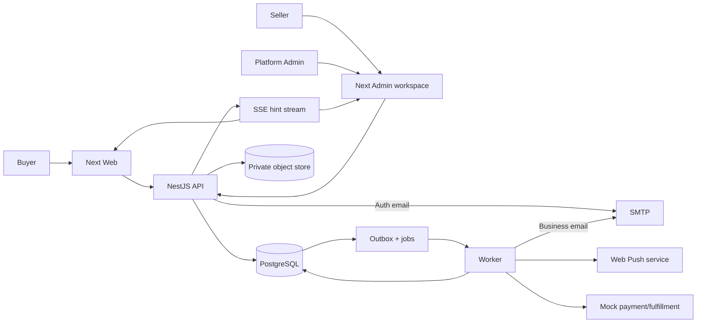

# Kiến trúc hệ thống

## 1. Quyết định nền và topology

Marketplace MVP có **Web, Admin dùng chung cho Seller và Platform Admin, API, Worker** là bốn process Node.js tách deploy; PostgreSQL là system of record; object storage private cho media; SMTP cho email; Web Push qua browser push service. TypeScript monorepo và NestJS modular monolith giữ checkout nhiều context trong một transaction. Seller là tenant logic, không tách database/schema theo shop. Service/queue riêng chỉ thêm theo đo lường. **F1 không có payment/carrier/payout thật cho đơn Cartasy**. Monetization quảng cáo/affiliate thật trong tương lai là context và gate khác, không thay mock checkout; xem [ADR-0010](../decisions/ADR-0010-simulated-commerce-real-monetization-boundary.md). Ranh giới một app quản trị ở [ADR-0011](../decisions/ADR-0011-unified-admin-seller-workspace.md).

[Stack](../platform/stack-dependencies.md) sở hữu package/version, [Integrations](../platform/external-integrations.md) sở hữu provider/transport decision, [Packages](../packages/README.md) sở hữu shared source, [App guides](../apps/README.md) sở hữu `src` từng app.

## 2. Process và dependency

| Thành phần | Sở hữu | Không được làm |
|---|---|---|
| `apps/web` | Public SSR/SEO, buyer UI, client session/inbox/push | Query DB/tính giá/quyết định quyền |
| `apps/admin` | Một workspace: Seller `/seller/*` shop-scoped và Platform Admin `/platform/*` governance/moderation/CMS/ops | Coi route UI là quyền, giữ cache shop/role cũ sau switch hoặc cho Admin thao tác Seller mặc định |
| `apps/api` | HTTP/auth/SSE, validation, OpenAPI, composition root | SQL/domain rule trong controller |
| `apps/worker` | Outbox/jobs, mock settlement, campaign fanout, SMTP/push, projection/scheduler | Business rule khác API, work item không idempotent |
| `packages/server` | Domain/application/ports theo context | Import Nest/Drizzle/Next |
| `packages/database` | Drizzle schema/repository/UnitOfWork/read model | Export DB client cho UI |
| `packages/contracts/config/observability/testkit` | Wire types, typed env, telemetry, test fixture | Chứa feature rule không có owner |

Frontend chỉ import public package exports. API/worker bind adapter vào public application ports. Database adapter có thể import port type từ server, server không biết database. Không module ghi trực tiếp bảng module khác; read model cross-context có thể join read-only. Có dependency-cruiser/ESLint architecture gate.

## 3. Bounded context và dữ liệu chủ sở hữu

| Context | Module | Nguồn ghi |
|---|---|---|
| Identity & customer | `identity, customers` | Credential/session/MFA, profile/address |
| Marketplace | `shops, seller-onboarding` | Shop/application/membership/capability |
| Catalog & content | `catalog, listings, media, cms` | Product/variant/category/listing/media/page |
| Discovery | `discovery, recommendations, wishlist` | Search/recommendation projection, wishlist |
| Commerce | `inventory, carts, pricing, promotions, checkout, flash-sales` | Stock/reservation/cart/campaign/quote orchestration |
| Transaction | `payments, orders, fulfillment` | Mock payment, order/shop order, shipment |
| Service & trust | `reviews, risk, returns, support` | Review/report/action/return/ticket |
| Engagement | `notifications, communications, analytics, reporting` | Inbox/campaign/preference/delivery, event/projection |
| Growth | `advertising, affiliate` | F3 ad serving và outbound partner referral; không ghi buyer order thật |
| Monetization & Finance | `ad-billing` (chỉ khi được duyệt sau MVP) | Hợp đồng/invoice/receipt/refund/ledger quảng cáo thật, tách `payments` mô phỏng |
| Platform | `audit, outbox, jobs` | Audit/event/work item |

Module F2/F3 có boundary và contract được đặc tả trước nhưng chưa tạo runtime/schema nếu chưa triển khai. `checkout` là orchestrator, không sở hữu mọi bảng; UnitOfWork cho các owner tham gia cùng transaction. `shop_id` áp dụng ngay F1 cho listing/stock/shop-order/promotion/support/report và mọi seller operation.

External affiliate offer không phải Cartasy listing: redirect tới đối tác không chạm cart/checkout, event click không là payment outcome. Partner conversion report và ad billing là dữ liệu thương mại có bằng chứng riêng, không join/suy từ mock `paid_simulated` để ghi doanh thu thật. API namespace, secret, role, event và reporting projection tách; F3 có thể dùng cùng deploy/DB ban đầu nhưng migration và owner khác. [Affiliate](../domains/affiliate.md), [Ad billing](../domains/advertising-billing.md).

## 4. Consistency và checkout

Client gửi cart version/quote fingerprint/`Idempotency-Key`; API xác thực actor và khóa cart, stock rows theo ID. Server đọc listing/shop/promotion authoritative, tính VND integer; giá khác trả conflict yêu cầu buyer xác nhận lại. **Một transaction**: cart close, inventory/voucher hold, order + N shop orders/items/address/price snapshots, payment pending, idempotency record và outbox. Lỗi rollback tất cả. Không gọi SMTP/mock gateway/network trong transaction.

Worker settlement success/failure/timeout dùng stable attempt/event ID và CAS state. Success commit reservation/voucher, order confirmed, tạo shipment mô phỏng; failure release; timeout pending đến deadline rồi kết luận theo policy. Hủy/return tạo refund mô phỏng theo snapshot và restock qua owner use case, cap `refunded <= paid_simulated`. Transaction/event trùng không nhân đôi side effect. [Business flows](business-flows.md), [Data model](data-model.md), [domain specs](../domains/README.md) có trạng thái chi tiết.

## 5. Event, queue, notification và realtime

Domain event versioned được ghi `outbox_events` trong transaction nguồn; worker poll `FOR UPDATE SKIP LOCKED`, lease/heartbeat, bounded retry/dead-letter và `inbox_events` unique per consumer. Work không bắt nguồn trực tiếp từ transaction (campaign fanout, scheduled mock shipping, projection rebuild) dùng `background_jobs` với checkpoint/retry riêng; không coi PostgreSQL `LISTEN/NOTIFY` là queue bền vững. Event payload chỉ IDs/version/correlation, không PII/token.

Order/shop transition → recipient resolver → notification inbox + channel delivery; email qua SMTP, browser push opt-in qua Web Push. Campaign sản phẩm mới/promotion/system đi qua approval, audience snapshot/consent/frequency cap, fanout batch; không tạo một outbox event/transaction khổng lồ. SSE báo có notification/order update khi tab mở; client refetch DB-backed API, hỗ trợ cursor/replay/poll fallback. WebSocket chưa cần cho notification một chiều. [Communications](../domains/communications.md) là nguồn hành vi, [Integrations](../platform/external-integrations.md) là nguồn transport.

## 6. Cache, search và read model

PostgreSQL primary quyết định giá, stock, quyền, payment và quota. Public catalog/search F1 dùng PostgreSQL full-text/trigram + index/read model, keyset cursor; Next cache public response theo tag/TTL ngắn, invalidate từ outbox, revalidate checkout trên primary. Private profile/cart/order/inbox/seller report không đưa vào shared CDN cache; client React Query key theo actor/shop, clear khi logout/role/shop đổi. Server API có thể dùng cache per-request ngắn cho reference data public nhưng không cache authorization/stock. Read replica/Redis/search engine chỉ thêm khi query plan, lag/SLO và invalidation được đo/ADR chấp nhận.

## 7. Auth, quyền và trust boundary

Better Auth cookie host-only tại API origin; Web/Admin là same-site sibling origin, gọi API `credentials: include` và Origin/CSRF defense. Public page SSR; private data client fetch vì Next origin không nhận API host-only cookie, trừ khi sau này có BFF/shared-cookie ADR. API default-deny, application kiểm actor/global role/shop membership/capability/status/resource ownership mỗi request. Cùng một Admin origin không hợp nhất quyền: `/v1/seller/*` kiểm membership/shop resource; `/v1/admin/*` kiểm platform capability. SSE/Web Push subscription/export/campaign cũng là resource có quyền, không dựa vào ẩn nút UI. Dữ liệu seller chỉ shop mình; quyền break-glass Admin chỉ theo policy riêng, có recent auth, reason và audit.

## 8. Khả năng mở rộng và điều kiện tách

Baseline container Node portable, API/worker horizontal scale với PG connection budget và lease/idempotency; SSE cần connection cap/heartbeat/replay. Khi F1 traffic tăng: đo p95 query, outbox/campaign lag, DB CPU/connections, SSE connections và cost; tối ưu index/batch/read model trước. Sau đó có thể thêm read replica, Redis Streams/BullMQ, CDN/search engine hoặc tách service, nhưng outbox vẫn bảo đảm event sau commit. Mỗi thay đổi có ADR, migration N/N-1, failure/recovery test và ownership mới. Payment/carrier thật không là thay adapter vô điều kiện; cần đặc tả tài chính/pháp lý riêng.
