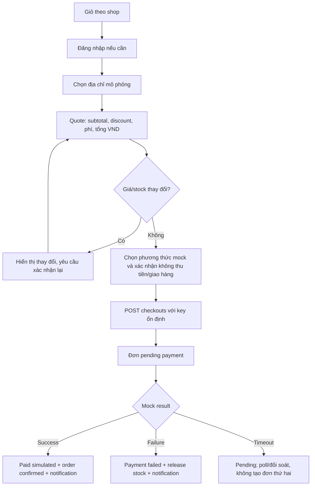

# Luồng người dùng

## 1. Điều hướng F1

```text
/                  Trang chủ
/categories/:slug  Danh mục
/search            Tìm kiếm, filter, sort
/products/:slug    Product + variant + listing theo shop
/shops/:slug       Gian hàng
/cart              Giỏ theo shop
/checkout          Địa chỉ, phí, coupon, payment method, xác nhận mô phỏng
/orders            Danh sách đơn
/orders/:id        Chi tiết, payment, shop order và timeline
/wishlist          Danh sách yêu thích
/reviews           Đánh giá trải nghiệm mô phỏng
/returns           Yêu cầu đổi trả/hoàn tiền mô phỏng
/support           Ticket hỗ trợ và hội thoại
/notifications     Thông báo
/account           Hồ sơ và địa chỉ
/auth/*            Đăng ký, đăng nhập, xác minh, khôi phục
```

Một `apps/admin`/origin có khu Platform `/platform/*` (catalog, listings, inventory, promotions, orders, shop-applications, shops, CMS, notification-campaigns, reports, moderation, operations) và khu Seller `/seller/*` (`apply`, `applications/:id`, `shops/:shopId/*` cho listing, inventory, order, support, notification proposal, report). Navigation theo capability; API vẫn kiểm `/v1/admin/*` và `/v1/seller/*` độc lập. [ADR-0011](../decisions/ADR-0011-unified-admin-seller-workspace.md).

## 2. FLOW-01 — Khám phá và chọn listing

1. Guest/user mở trang chủ, danh mục hoặc search. Query/filter/sort nằm trong URL, có trạng thái loading/empty/error.
2. Product card cho thấy giá VND “từ” listing hợp lệ, shop và media đã duyệt; không hiển thị review/đã bán hư cấu như dữ liệu thật.
3. Product Detail cho chọn variant rồi listing của shop; hiển thị giá, tồn kho/giới hạn, phí giao nhận mô phỏng và tên shop.
4. Thêm giỏ dùng `listingId + quantity`. Nếu listing thay đổi/hết hàng, UI đọc lại và giải thích hành động tiếp theo.

## 3. FLOW-02 — Guest cart và đăng nhập

Guest cart chỉ lưu `listingId`, quantity, schema version ở local storage; không lưu địa chỉ/session/giá. Khi đăng nhập, web gọi `/cart/merge` với một idempotency key được giữ qua reload. Server tính lại giá/tồn kho, trả item được merge, điều chỉnh hoặc loại. Chỉ xóa guest cart sau response thành công. Timeout giữ key và retry; không cộng quantity lần hai. Session hết hạn giữ ý định và quay về checkout sau login.

## 4. FLOW-03 — Checkout và mock payment



Màn hình xác nhận có câu: **“Đây là giao dịch mô phỏng. Cartasy không thu tiền và không giao hàng thật.”** Checkbox/hành động xác nhận nằm cạnh tổng, không bị ẩn trong Terms. Sau POST timeout, web tra `/checkouts/by-key/:key` trước khi cho thử lại. Không hướng dẫn nhập thẻ/OTP thật. Người dùng có thể rời trang; notification và trang đơn vẫn phản ánh kết quả.

Payment failure kết thúc order đó và giải phóng tồn kho; hành động “Thử đặt lại” tạo giỏ/checkout mới từ các item còn hợp lệ, không retry bằng order pending cũ. Payment timeout vẫn giữ cùng order/key để đối soát.

Nếu giỏ nhiều shop, quote nhóm theo shop, mỗi nhóm có item/discount/phí; order tạo nhiều shop order. Nếu một shop bị suspend/listing bị unpublish, checkout từ chối và cho sửa giỏ, không âm thầm bỏ item sau khi xác nhận.

## 5. FLOW-04 — Theo dõi/hủy đơn

- Trang order list có mã đơn, ngày, tổng VND, trạng thái mock payment và số shop.
- Chi tiết có timeline chung và từng shop order; nhãn “giao nhận mô phỏng” cạnh các bước đóng gói/đang giao/đã giao.
- Người dùng được hủy toàn đơn nếu mọi shop order còn đủ điều kiện, hoặc hủy một shop order trước `shipping_simulated`. Khi hủy, stock reservation hoặc stock đã commit được bù qua nghiệp vụ có audit; payment đã `paid_simulated` chuyển `partially_refunded_simulated` hoặc `refunded_simulated` theo số shop còn lại và lượt coupon được hoàn theo policy. “Hoàn tiền mô phỏng” không là giao dịch ngân hàng.
- Hủy không hợp lệ trả `INVALID_STATE_TRANSITION`, UI tải lại timeline và giải thích.
- Email/in-app notification dẫn về order của actor; người khác mở link nhận 404/đăng nhập, không lộ địa chỉ.

## 6. FLOW-05 — Admin vận hành

1. Admin đăng nhập và qua MFA; API kiểm tra role hiện hành.
2. Tạo product/variant/media, xác nhận quyền nội dung, gắn category/brand; duyệt proposal/listing của seller hoặc tạo nội dung platform theo quyền, nhập giá VND và stock cho listing được phép.
3. Preview rồi publish product/listing. Thiếu media/quyền/category/variant/stock/policy được liệt kê thành blocker có mã ổn định.
4. Theo dõi order/shop order; chuyển trạng thái mô phỏng qua state machine, nhập lý do với thao tác hủy/điều chỉnh; người mua nhận notification.
5. Chỉnh giá/stock/promotion có `If-Match`; xung đột yêu cầu tải lại, không ghi đè im lặng.
6. Admin thao tác theo role; audit lưu actor, mục tiêu, lý do và version.

## 7. FLOW-06 — Wishlist, review, return và support

1. Guest nhấn tim ở product card/detail, dữ liệu ở local storage; sau login merge vào wishlist server, mục không còn bán được đánh dấu unavailable. Buyer có thể mở wishlist và chọn listing hợp lệ để thêm cart.
2. Sau `delivered_simulated`, order detail cho phép đánh giá **trải nghiệm mô phỏng** một lần trên mỗi item. Form nêu rõ không đánh giá chất lượng sản phẩm đã dùng; review vào moderation queue, công bố sau duyệt, notification khi có quyết định.
3. Buyer chọn item/quantity của shop order đã delivered, nêu lý do và gửi return request trong cửa sổ 7 ngày. Admin xem bằng chứng, phê duyệt/từ chối có reason. Phê duyệt ghi refund mô phỏng theo snapshot và notification; không yêu cầu gửi hàng hay chờ tiền về tài khoản. Request lỗi/hết hạn cho mở ticket.
4. Buyer mở support ticket từ order/return hoặc trang tài khoản, nhận phản hồi qua inbox/email; admin phân công/ghi internal note và theo SLA. Seller F1 chỉ tham gia ticket shop được cấp quyền. Ticket không trực tiếp sửa payment/order; agent dùng command của owner và audit.

## 8. FLOW-07 — Seller MVP đa shop

Người bán nộp đơn mở shop → Admin duyệt/xác minh → nhận capability → tạo draft/listing/stock → gửi duyệt → publish theo policy → xem shop order mô phỏng và báo cáo tổng hợp. UI luôn hiển thị shop đang chọn; đổi shop xóa form/cache theo tenant. Seller không xem order/địa chỉ của shop khác, không quyết định payment outcome và không tự cấp quyền.

## 9. FLOW-08 — Thông báo đơn, sản phẩm mới và hệ thống

1. Order/shop-order đổi state có audit/outbox. Worker resolve buyer và seller đúng shop, tạo inbox; email/push theo policy. Buyer thấy “đang giao mô phỏng”, Seller chỉ thấy phần shop mình.
2. Seller gửi đề xuất thông báo sản phẩm mới/promotion của shop; Admin duyệt audience/nội dung. Product/listing phải public lúc schedule và lúc fanout. Buyer marketing opt-in mới nhận email/push; in-app theo preference.
3. Admin tạo system announcement về tính năng/maintenance đã bật cho audience, có preview và người duyệt thứ hai nếu critical. Campaign fanout batch, có tiến độ/pause/report; không gửi trùng sau retry.
4. Tab mở nhận SSE hint rồi refetch inbox/order; tab đóng dùng Web Push nếu user đã cho phép, nếu không vẫn có inbox/email. Trên iOS push cần web app trên Home Screen; UI có hướng dẫn và không hứa push cho mọi browser.

## 10. FLOW-09 — CMS, báo cáo và trust

Admin draft/preview/duyệt/publish CMS block theo revision và schedule; trang public chỉ đọc revision đã publish. Seller/Admin xem báo cáo aggregate đúng scope với `asOf` và độ trễ projection, không trình bày doanh thu mô phỏng như tiền thật. Buyer/seller gửi report nội dung vi phạm; moderator tách quyền xem evidence và quyết định takedown có reason/audit, bên bị ảnh hưởng có đường appeal qua support. Xem [CMS](../domains/cms-content.md), [Reporting](../domains/reporting.md) và [Trust & Safety](../domains/risk-moderation.md).

## 12. FLOW-10 — Quảng cáo và affiliate outbound sau MVP

Seller/Advertiser có quyền tạo ad draft → Admin kiểm duyệt creative/placement/claim → campaign chỉ phân phối khi eligibility và commercial policy được xác nhận → Buyer thấy nhãn “Quảng cáo” → impression/click được đo theo consent/fraud policy → báo cáo tách performance khỏi ad invoice/receipt. Nếu thu tiền quảng cáo thật, advertiser thanh toán trong [ad-billing](../domains/advertising-billing.md), **không** qua Buyer cart/checkout; failure/refund/credit note không đổi mock order. [Advertising](../domains/advertising.md).

Buyer thấy external offer có nhãn “Liên kết tiếp thị” → đọc thông báo sẽ rời Cartasy để mua thật trên đối tác → bấm CTA → server kiểm partner/offer/link/consent và redirect allowlisted → đối tác sở hữu đơn/thanh toán/giao hàng thật → Cartasy chỉ ghi conversion/commission sau partner report hợp lệ, rồi đối soát riêng. Nếu offer hết hạn, URL lỗi, thiếu quyền/consent hoặc partner bị khóa, không redirect mù; trả trang lỗi an toàn. Không tạo Cartasy order, không hứa support/refund đơn đối tác. [Affiliate](../domains/affiliate.md), [ADR-0010](../decisions/ADR-0010-simulated-commerce-real-monetization-boundary.md).

## 11. Trạng thái giao diện bắt buộc

Mỗi luồng dữ liệu có loading, empty, recoverable error/retry, permission denied, not found và session expired. Checkout/payment có thêm: price changed, stock changed, duplicate submit, network timeout sau commit, payment pending lâu, failure, cancel conflict và notification delayed. Loading không đồng nghĩa thành công; không tự đổi “pending” thành “paid” chỉ vì client hết chờ.
